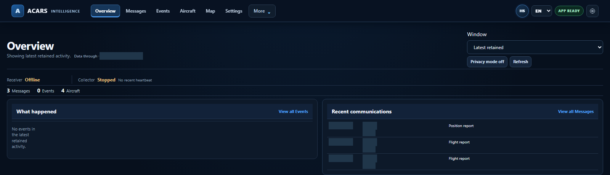
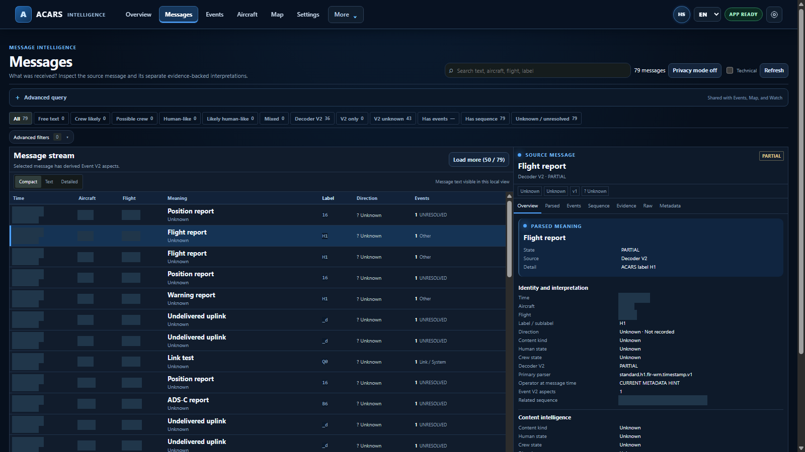
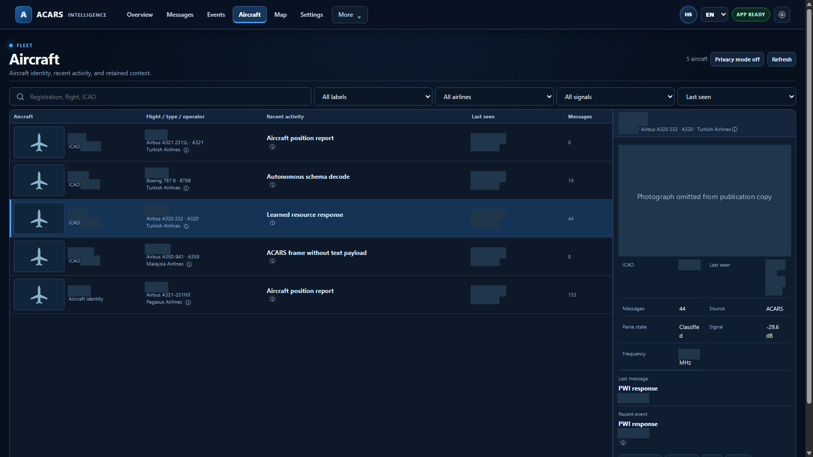
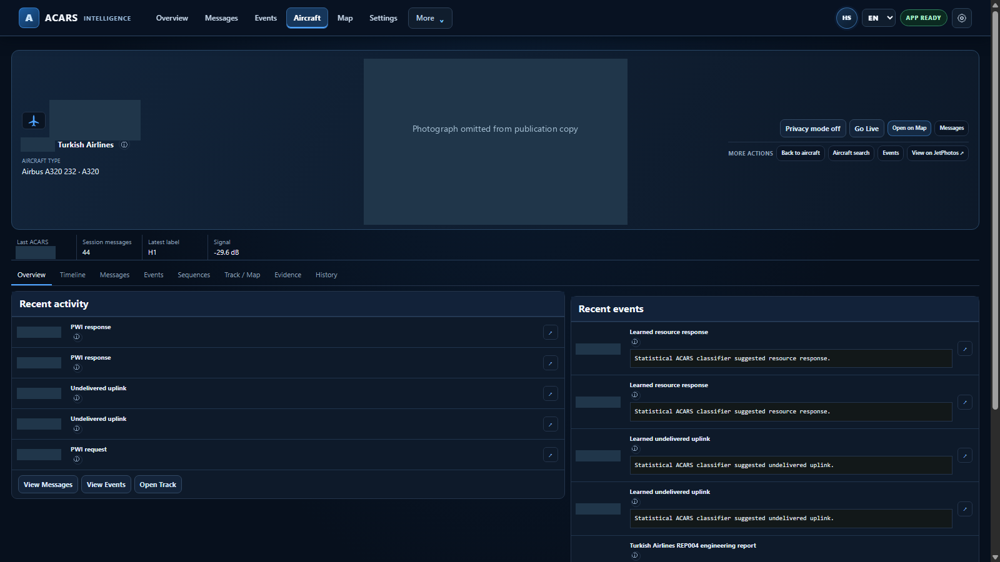
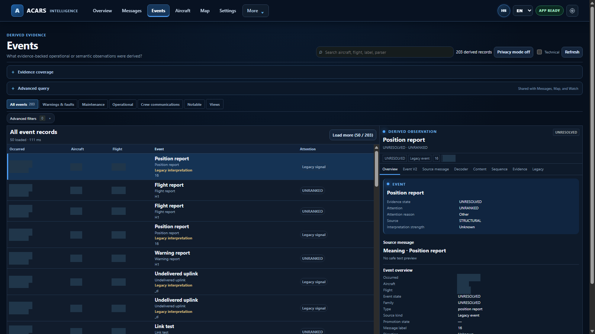
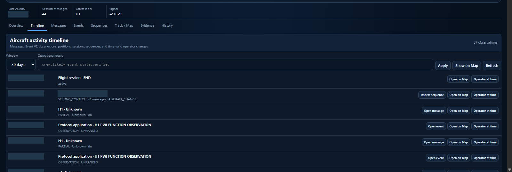
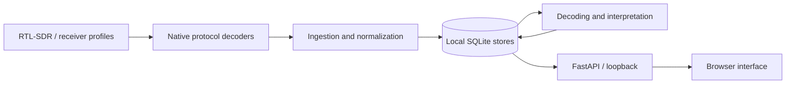
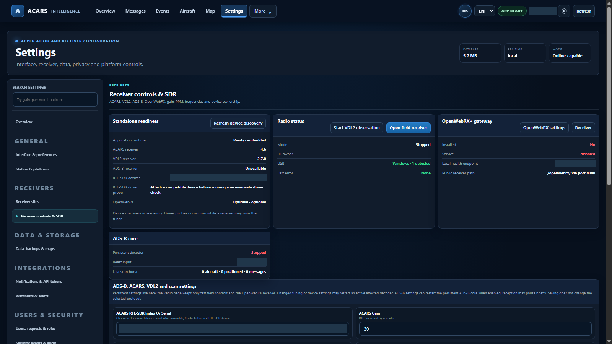

# ACARSINT

A local aircraft data collection and analysis platform built around ACARS, VDL Mode 2 and ADS-B.

ACARSINT retains received messages and brings their original payloads, decoded fields, aircraft context, histories and related events into one browser interface. It runs locally, with SQLite storage and private Windows x64 and native Linux x86_64 packages. RC5.1 is frozen.

<a href="assets/screenshots/01-overview.png"></a>

*Overview — recent retained activity and receiver state in the packaged application.*

## Why I built it

I started by receiving ACARS messages with SDR equipment and looking at what they contained. A decoder could show the next message, but I wanted to keep the original text, inspect unfamiliar formats and return to an aircraft's earlier activity. ACARSINT gradually grew around those needs: collection, storage, decoding, and a way to explore the records without losing their source context.

The result is a Python backend and a JavaScript interface for moving between messages, aircraft, events, sessions and recorded positions. The application keeps a received report separate from the conclusions a parser or classifier draws from it.

## Interface

These captures come from the packaged Windows RC5.1 application, using **232 genuine retained messages across five aircraft**. The observations are historical, not a live feed. Open an image for a larger view.

<table>
<tr>
<td><a href="assets/screenshots/02-messages.png"></a><br><sub>Messages — retained records and their decoder/evidence context.</sub></td>
<td><a href="assets/screenshots/04-aircraft-list.png"></a><br><sub>Aircraft — a table of retained types, operators and activity.</sub></td>
</tr>
<tr>
<td><a href="assets/screenshots/05-aircraft-overview.png"></a><br><sub>Aircraft Detail — recent message activity within a retained session.</sub></td>
<td><a href="assets/screenshots/20-historical-map-regional.png"></a><br><sub>Historical Map — recorded ACARS context on a real basemap.</sub></td>
</tr>
</table>

Aircraft registrations, callsigns, exact observation times, precise positions and private identifiers are masked. The map uses a real OpenStreetMap basemap with its exact observation marker withheld.

<table>
<tr>
<td><a href="assets/screenshots/03-events.png"></a><br><sub>Events — source, interpretation and evidence state.</sub></td>
<td><a href="assets/screenshots/08-aircraft-timeline.png"></a><br><sub>Timeline — different evidence layers in their historical context.</sub></td>
</tr>
</table>

The [complete interface tour](docs/gallery.md) includes the contact sheet, session history, aircraft messages, source evidence, sequences and receiver configuration.

## What it does

- **ACARS:** manages receiver profiles, ingests decoder output and retains original payloads with available reception measurements.
- **VDL Mode 2:** retains native frames and ACARS messages carried over VDL2, preserving their transport provenance.
- **ADS-B:** ingests local decoder states and available positions for aircraft tracking. Windows has a managed Dump1090 adapter; Linux bundles `readsb`.
- **Messages and decoding:** searchable protocol labels, raw text, structured parser fields, related-message sequences and separate classification results.
- **Aircraft context:** identity metadata, retained histories, flight-session groupings, timelines and Flight Story views linked to their observations.
- **Events and maps:** derived event records, supporting evidence and historical positions with explicit source context.
- **Optional enrichment:** local aircraft metadata and exact-registration photo catalogs, plus opt-in fresh photo discovery governed by offline/privacy settings and provider availability.

Receiver profiles assign physical devices independently. Upstream programs handle RF demodulation; ACARSINT manages their processes and works with their output. It does not replace the decoders' native multichannel DSP.

## How it works



Some structured fields arrive from upstream decoders and `libacars`; others are extracted by the application's parsers. Heuristic labels, learned-model output and derived events remain separate from the original message. Classifier scores are not calibrated probabilities. The [architecture notes](docs/architecture.md) describe these processing stages and the stores behind them.

## Examples from recorded data

The source archive contains **125,050 retained message rows**: 73,407 native ACARS decoder-origin records and 51,643 VDL2 bridge rows. A separate VDL2 store contains 18,772 frames. Bridge representations can refer to the same reception, so these totals must not be added as independent RF observations. The interface tour uses only a small curated subset.

### ADS-C over VDL2

A retained ARINC 622 message exposes an ADS-C report type, CRC result and structured basic-report fields. Altitude, position accuracy and status flags remain visible below; addresses, contract identifiers, exact timing and coordinates are withheld.

<a href="assets/screenshots/10-adsc-decoding.png"></a>

This is **ADS-C carried in ACARS over VDL2**, not an ADS-B observation. The deterministic fields and the historical heuristic/model badges are different processing results.

### Structured maintenance report

An H1 message has matching VDL2 frame evidence with sublabel `CF`. Its `FLR` payload names GPS antenna, coax cable and MMR-related components. The decoder extracts ATA chapter, section and item **34/36/00**.

<a href="assets/screenshots/11-maintenance-report.png"></a>

The historical interface calls this “Aircraft system fault” and also shows older classification badges. The supported statement is narrower: a received fault-report payload names those components. It does not independently prove a failed component, its cause, a hazardous condition or a completed repair. The structured payload is not presented as natural-language communication.

### Readable operational text

Another retained message contains a greeting, routine ETA content and a closing. Its original words remain visible in the Raw tab, with routing, aircraft identifiers and ETA redacted.

<a href="assets/screenshots/12-readable-text.png"></a>

The text is readable; human authorship and a two-way exchange are not independently established. A historical generic extractor mistook part of the header for a time. That extraction is excluded from this view rather than shown as successful decoding.

## Installation

Authorized holders obtain the private package through the owner. There are no executable downloads or public binary releases in this repository. Verify the package checksum before extraction; exact filenames, SHA-256 values and first-run instructions are in [installation](docs/installation.md).

**Windows x64:** extract into a new directory and run:

```powershell
.\ACARSINT.exe
```

Complete the local Setup Wizard with its one-time token, create the administrator account and configure the intended receivers. The Python runtime and application dependencies are included. Use **Settings → Overview → Shut down platform safely** when finished.

**Native Linux x86_64:** the verified baseline is Debian 12 with glibc 2.36.

```sh
tar -xzf ACARSINT-Core-v0.10.0-rc5.1-linux-x86_64.tar.gz
cd ACARSINT-Core-v0.10.0-rc5.1-linux-x86_64
./acarsint doctor
./acarsint
# Later, in another terminal:
./acarsint stop
```

The default interface is `http://127.0.0.1:8080`. Python, required application libraries and native decoders are bundled. A browser and host USB permissions are separate prerequisites; no operator-side Python package installation or decoder compilation is required. The detailed guide covers persistent data paths and non-root RTL-SDR access. OpenWebRX is optional.

<details>
<summary>Receiver settings in the running Windows application</summary>
<p><a href="assets/screenshots/13-receiver-settings.png"></a></p>
<p>This historical showcase leaves receivers stopped. Settings availability and decoder probes are not a new physical RF acceptance test.</p>
</details>

## Technical details

Python, FastAPI and SQLite form the backend. The frontend uses HTML, CSS and JavaScript modules, with MapLibre GL for maps.

| Component | Windows x64 | Native Linux x86_64 |
|---|---|---|
| Python runtime | CPython 3.14.8 | CPython 3.12.14 |
| ACARS | `acarsdec` 4.6 | `acarsdec` 4.6 |
| VDL2 | `dumpvdl2` 2.7.0 | `dumpvdl2` 2.6.0 |
| Structured ACARS library | `libacars` 2.2.1 | `libacars` 2.2.1 |
| ADS-B receiver | Pinned Dump1090 with loopback patch | `readsb` 3.16.17+0272517 |
| SDR components | RTL-SDR 2.0.3 | RTL-SDR 2.0.3 |

## Data and limitations

SQLite data stays local and the HTTP interface binds to loopback by default. Offline Mode is enabled on first run. Optional remote photo/metadata lookups can disclose a requested aircraft identifier to the provider; message payloads are not sent to photo services.

The supplied historical ADS-B observation tables were empty. This presentation therefore does not claim a historical three-protocol fusion result. Linux packaged software acceptance passed on Debian 12 using decoder probes and labeled fixtures; physical Linux RTL-SDR reception, hot-unplug and simultaneous physical multi-SDR operation were not verified.

Session groupings are application context, not independently confirmed complete flights. Recorded positions do not establish continuous surveillance. Further testing boundaries, photo-use restrictions and distribution requirements are in [limitations](docs/limitations.md).

## Development

Most of the work went into retaining useful source evidence, handling different decoder formats, relating observations conservatively and making startup, persistence and shutdown reliable in packaged installations. The interface grew alongside those needs.

RC5.1 is frozen. This repository presents the finished personal engineering project. Core remains private; no software license or public binary redistribution permission is implied by these documentation assets.
