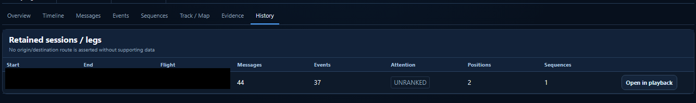
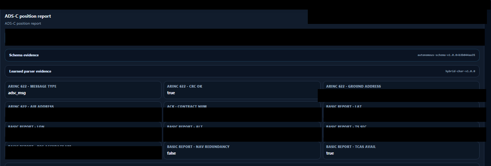
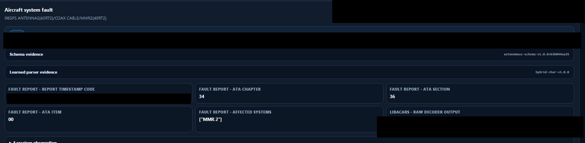
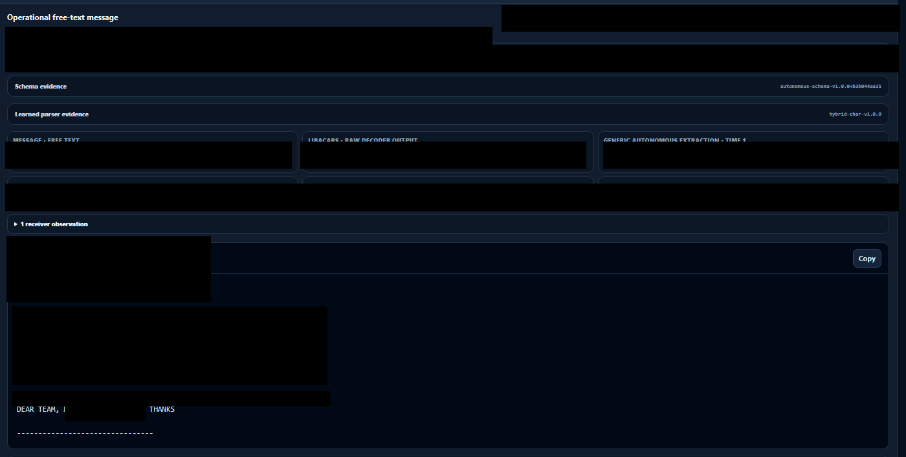
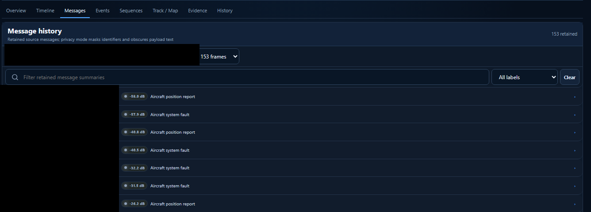
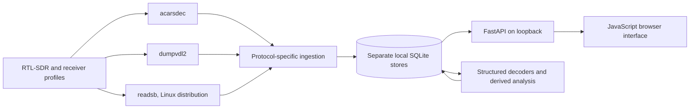

# ACARSINT

ACARSINT is a local aircraft-data collection and analysis application. It brings together messages and receiver observations from ACARS and VDL Mode 2, with ADS-B ingestion and tracking in the native Linux distribution. Its browser interface lets me inspect retained messages, decoded fields, aircraft histories, derived events and historical positions.

This repository documents a finished, private RC5.1 project. It contains neither the Core source nor databases, receiver recordings or software packages.

## Screenshots

These are genuine captures from the packaged application and the isolated historical showcase. The published image copies have opaque redactions for identities, dates, times, addresses and precise positions. Black bars are the redactions; they contain no hidden or reversible data. No aircraft photographs are included.

<table>
<tr>
<td><br><sub>Overview · retained activity with private fields redacted.</sub></td>
<td><br><sub>Aircraft history · session context with identity and interval removed.</sub></td>
</tr>
<tr>
<td><br><sub>ADS-C over VDL2 · message type and CRC field, with identity and position values hidden.</sub></td>
<td><br><sub>Structured FLR payload · ATA fields and component references. A report does not prove a confirmed failure.</sub></td>
</tr>
<tr>
<td><br><sub>Operational free text · a short readable excerpt, with route and timing redacted.</sub></td>
<td><br><sub>Message history · protocol labels remain visible after identity and time fields were removed.</sub></td>
</tr>
</table>

The map is omitted from the gallery. The available local map capture had no basemap, and its historical track exposed precise positions and timing.

## How it grew

I started by receiving and examining ACARS messages with SDR equipment. Keeping useful records, decoding different message shapes and comparing activity over time became the next practical needs. I added VDL2, then aircraft histories, event analysis, timelines and a browser interface around the retained data. ADS-B ingestion followed in the Linux build. ACARSINT grew incrementally from the work of collecting and inspecting messages rather than from a plan to build a general tracking product.

## What it does

- Runs protocol-specific receivers and upstream decoders as separate processes.
- Stores decoded messages and available receiver/decoder measurements in local SQLite databases.
- Keeps original payloads beside structured parser output and later interpretations.
- Provides Messages, Events, aircraft details, history and session views.
- Shows stored positions in a historical map while retaining whether a point came from ACARS/ADS-C or ADS-B.
- Offers optional aircraft metadata/photo lookups. Offline and privacy settings control whether remote URLs can be requested or displayed.

`acarsdec`, `dumpvdl2` and `readsb` perform their own RF demodulation. ACARSINT manages receiver profiles, ingests output and presents the retained evidence; it does not replace those decoders.

### Main technologies

| Area | Components in the accepted packages |
|---|---|
| Application | Python, FastAPI, SQLite |
| Web interface | HTML, CSS, JavaScript modules, MapLibre GL for the map |
| ACARS | `acarsdec` 4.6 on Windows/Linux; `libacars` 2.2.1 |
| VDL2 | `dumpvdl2` 2.7.0 on Windows and 2.6.0 on Linux |
| ADS-B | `readsb` 3.16.17 in the Linux package; no integrated Windows ADS-B adapter in the final candidate |
| SDR support | RTL-SDR 2.0.3 utilities and bundled platform libraries; compatible USB hardware/host access are separate |

The Windows package carries CPython 3.14.8; the native Linux package carries CPython 3.12.14. Host glibc/ELF loader requirements apply to Linux. The accepted package notices retain the detailed Python-library and native dependency inventories.

### Receiver availability by package

| Package | Bundled receiver components | ADS-B receiver integration |
|---|---|---|
| Windows x64 | `acarsdec`, `dumpvdl2`, RTL-SDR utilities | No working ACARSINT ADS-B/readsb adapter in the final Windows candidate. A helper binary alone is not a supported adapter. |
| Native Linux x86_64 | `acarsdec`, `dumpvdl2`, `readsb`, RTL-SDR components | `readsb` ingestion and tracks were accepted with labeled fixture data. |

## A couple of real messages

The local historical archive has 125,050 stored message records. 73,407 have `acarsdec` provenance and 51,643 are VDL2 bridge records. A bridge row can represent the same VDL2-carried ACARS reception already present in another store, so those counts must not be added as independent receptions.

A retained structured FLR message names a GPS antenna, coax cable and MMR. ACARSINT exposes the report time and ATA 34/36/00 fields. This shows the message and the parser output; it does not establish a confirmed failure or cause.

A separate retained message contains a readable operational ETA communication. The excerpt below has been redacted and is not a verbatim transcript:

```text
[aircraft and ground-address header redacted]
DEAR TEAM, [flight and ETA redacted] THANKS
```

Classifier labels, model outputs and confidence scores are interpretations of the stored message. They are not calibrated probabilities or proof that a real-world failure or incident occurred.

The supplied historical ADS-B tables contain no aircraft states, track points or Comm-B observations. The archive therefore does not demonstrate a three-source ACARS/VDL2/ADS-B relationship.

## How the pieces fit



Original decoder output, deterministic parser results, heuristic classifications and derived events are separate evidence layers. The interface can show them side by side without turning a classification into an aircraft-status claim.

## Installation

The Windows x64 and native Linux x86_64 packages are private distributions for authorized holders. This repository does not provide binary downloads. Package names, checksums and setup commands are in [installation notes](docs/installation.md).

The verified Linux baseline is Debian 12 x86_64 with glibc 2.36. The Linux package includes Python 3.12.14 and application/receiver dependencies; the local interface runs without root or Docker. A browser and host USB permissions are separate prerequisites.

## Local data and network use

Messages, receiver settings and histories are stored locally. The application binds its HTTP interface to loopback by default. Offline Mode is enabled in first-run configuration. Optional metadata and photo lookups send the requested aircraft registration to the chosen provider when enabled; raw ACARS/VDL2 messages are not sent to those photo providers.

Keep station databases and receiver logs private. A privacy display mode is not a substitute for reviewing exported data. No database, RF recording, photo cache, credential or contact address is included in this repository.

## Development status and limits

RC5.1 is frozen. Linux software acceptance used labeled fixtures to exercise ACARS, VDL2 and ADS-B ingestion. Those fixtures are integration checks, not RF observations. Physical Linux RTL-SDR reception, simultaneous physical multi-SDR operation and hot-unplug were not tested in the Linux acceptance environment.

The historical classifier versions do not all match the current RC5.1 version. Unknown or legacy interpretations should be presented as such. The map needs configured tile access or a local tile pack; the application does not invent positions or interpolate a flight from sparse observations.

Read [architecture and evidence](docs/architecture.md) and [limitations and licensing](docs/limitations.md) for the technical scope and release boundaries.

## Source and licensing

ACARSINT Core is private/proprietary. This documentation repository makes no license grant and contains no application source or executable dependencies. Third-party components retain their own licenses. Public release licensing and redistribution review remain outstanding; the private Windows/Linux packages are not cleared for public redistribution.
