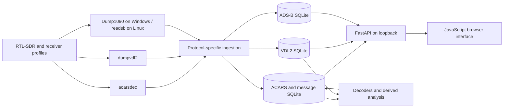

# Architecture

ACARSINT keeps signal demodulation in the upstream receiver programs. The application manages device profiles, receives decoder output, stores it locally and presents the retained evidence through a browser interface.

The Windows package contains `acarsdec`, `dumpvdl2` and a patched Dump1090 build. Its managed receiver service has a `dump1090` ADS-B engine: it writes a profile configuration, starts the executable and reads its loopback `aircraft.json` through the production ADS-B ingester. The native Linux package uses `readsb` and local JSON state. These paths were checked in the frozen package, not inferred from executable filenames.

An older Windows `receiver/README.md` says ADS-B is not integrated; it conflicts with the packaged receiver service, ingester and third-party receiver notice. This documentation follows the actual packaged code. The final photo acceptance did not repeat Windows physical RF acceptance. Both adapters retain upstream receiver executables as separate processes.

## Evidence layers

A retained source payload, deterministic parser fields, heuristic classification and derived event are different things. ACARSINT can display them together so a user can compare an interpretation with the original message. Historical classifier versions may disagree; current UI labels such as `Unknown`, `Observation` or `System fault` should be described as software output, not ground truth.

Some source archives contain a VDL2 frame and a corresponding ACARS application-message row. Those rows can represent the same reception. Registration/time overlap does not by itself prove a same-flight fusion. ADS-C positions transported in ACARS over VDL2 are not ADS-B observations.

SQLite stores are local and distinct for ACARS/messages, VDL2 and ADS-B observations. The UI reads through the local API. The historical databases used for this presentation contain no ADS-B track/state observations, so they do not substantiate a three-source historical example.
