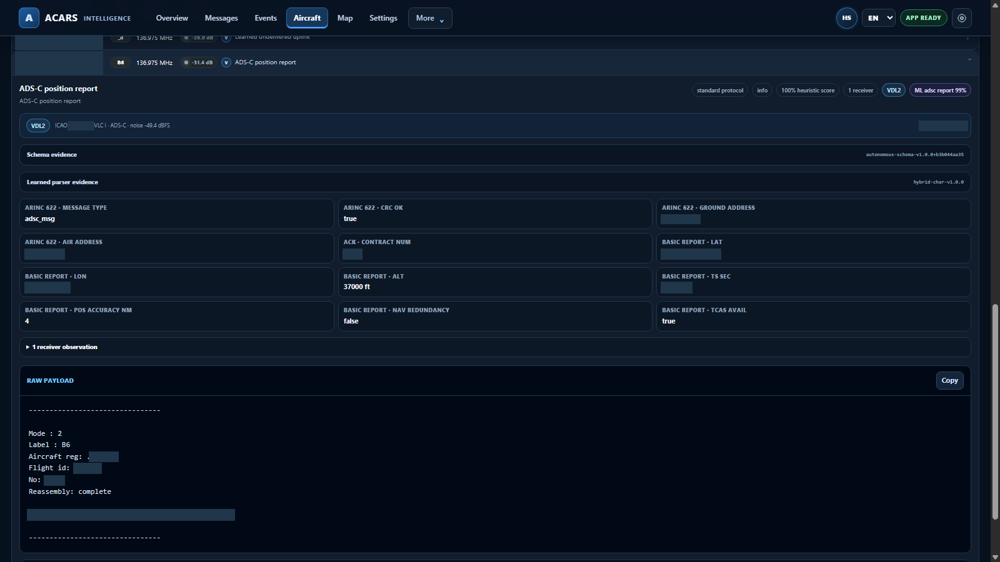
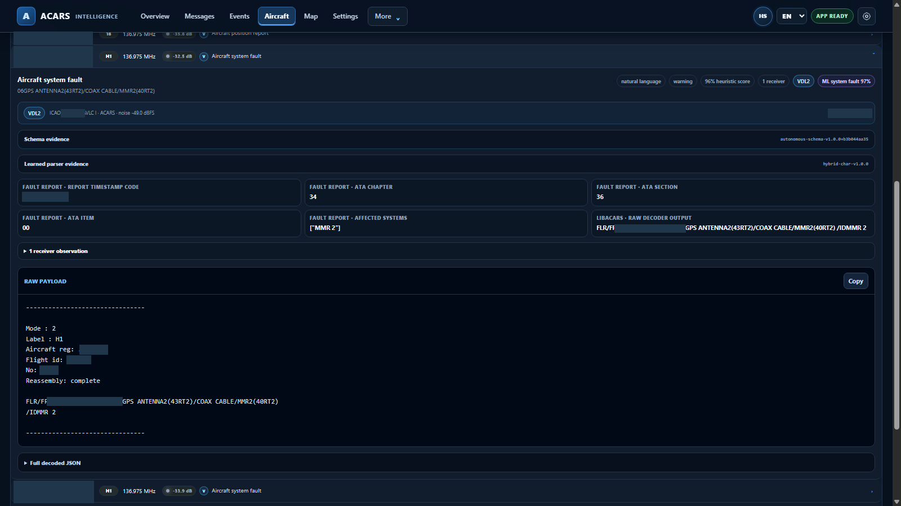
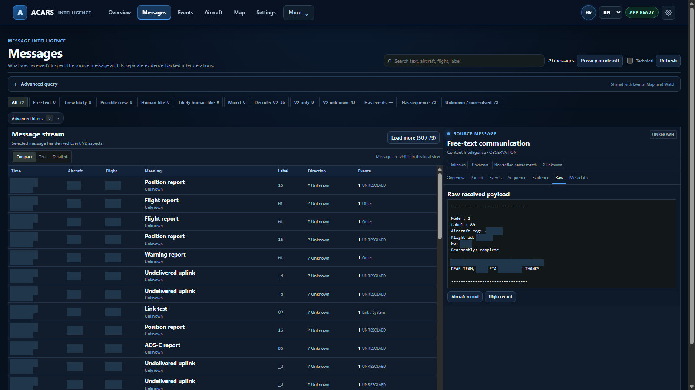
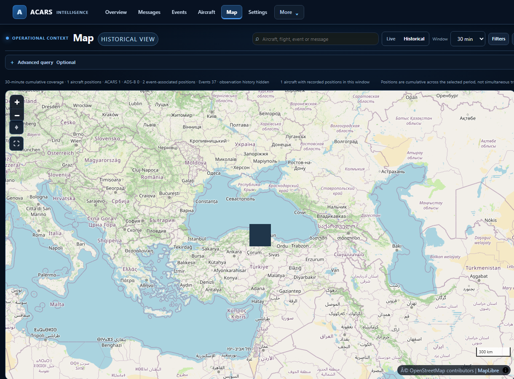

# Interface gallery

The images below are authentic views of the packaged Windows RC5.1 application using a curated set of 232 retained historical messages across five aircraft. The underlying observations were not modified. Aircraft identities, exact times, precise positions and sensitive payload spans are permanently masked. Several captures are tightly cropped to focus on the relevant workspace; no interface or result was reconstructed.

The legacy aircraft-photo catalog remains an application feature, but third-party photographs are not included here because the selected images do not have documented redistribution permission. See [limitations](limitations.md).

## Tour index

| View | Screenshot | What it shows |
|---|---|---|
| Overview | [Open image](../assets/screenshots/01-overview.png) | Recent retained counts, events and communications. |
| Messages | [Open image](../assets/screenshots/02-messages.png) | Populated message stream and decoder/evidence inspector. |
| Events | [Open image](../assets/screenshots/03-events.png) | Derived records with source and evidence states. |
| Aircraft List | [Open image](../assets/screenshots/04-aircraft-list.png) | Aircraft types, operators, recent activity and counts. |
| Aircraft Detail | [Open image](../assets/screenshots/05-aircraft-overview.png) | Retained message activity in a selected aircraft context. |
| Aircraft Messages | [Open image](../assets/screenshots/06-aircraft-messages.png) | Labels, measurements and retained message history. |
| Session History | [Open image](../assets/screenshots/07-aircraft-history.png) | One actual session grouping and its evidence counts. |
| Timeline | [Open image](../assets/screenshots/08-aircraft-timeline.png) | Layered observations and events in relative order. |
| ADS-C decoding | [Open image](../assets/screenshots/10-adsc-decoding.png) | ARINC 622 over VDL2; distinct from ADS-B. |
| Maintenance report | [Open image](../assets/screenshots/11-maintenance-report.png) | FLR payload and decoded ATA 34/36/00 fields. |
| Readable message | [Open image](../assets/screenshots/12-readable-text.png) | Original readable text with routing and timing concealed. |
| Receiver readiness | [Open image](../assets/screenshots/13-receiver-settings.png) | Packaged receiver status and integrations. |
| Receiver channels | [Open image](../assets/screenshots/14-receiver-channel-settings.png) | ACARS, VDL2 and ADS-B configuration controls. |
| Source evidence | [Open image](../assets/screenshots/15-aircraft-evidence.png) | Identity hints, source breakdown and session context. |
| Related sequences | [Open image](../assets/screenshots/16-related-sequences.png) | Bounded sequence context, not a conversation claim. |
| Historical Map | [Open image](../assets/screenshots/20-historical-map-regional.png) | Real OpenStreetMap tiles and broad regional context; exact marker withheld. |

## Message analysis

### ADS-C over VDL2

This is an ADS-C report carried over VDL2, not an ADS-B observation.

### Structured maintenance report

The payload names components; it does not independently establish a confirmed equipment failure.

### Readable operational text

The readable text is retained source content; authorship is not independently established.

## Aircraft context and settings

## Historical Map

The basemap is genuine, and the displayed positions are retained ACARS context. The concealed marker does not represent ADS-B.