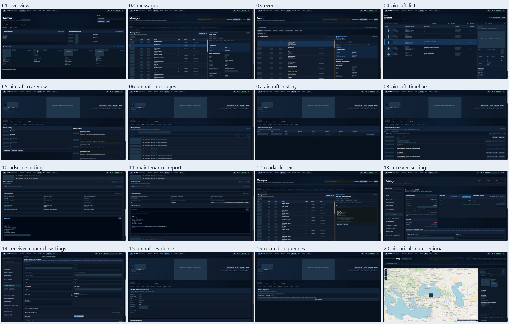
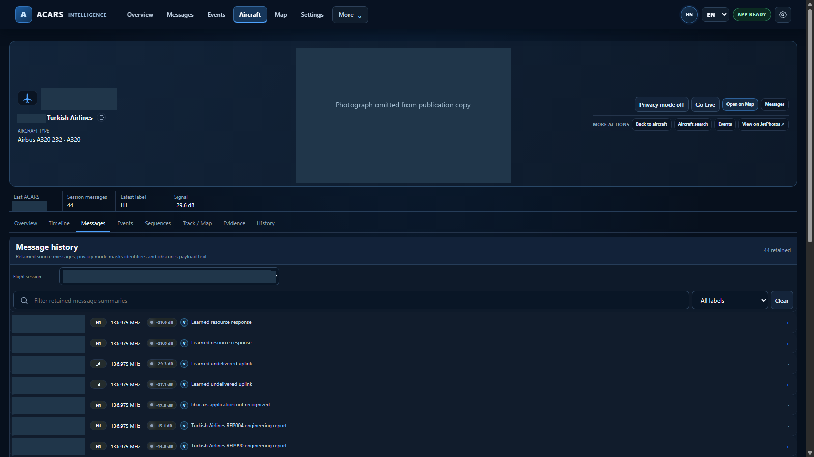
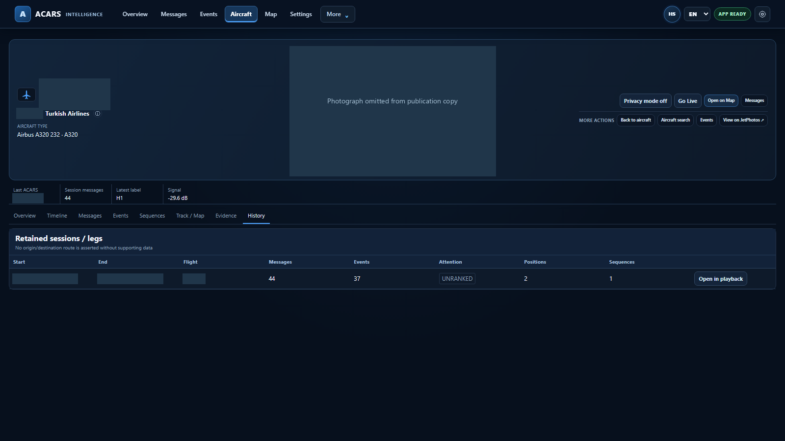
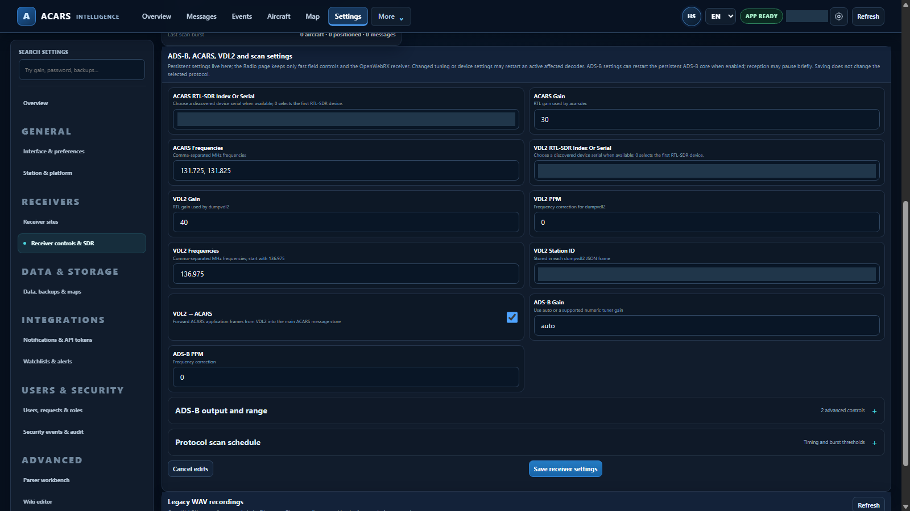
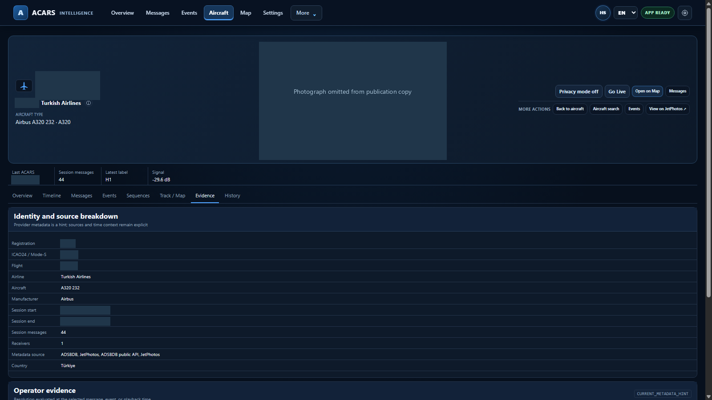
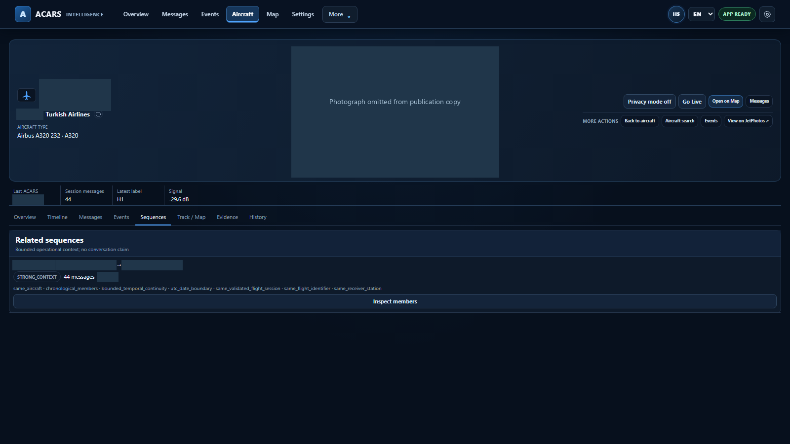

# Complete interface tour

These are genuine captures of the frozen Windows application with an isolated historical subset. All sixteen states were visited in Brave/Chromium at 1600×900. Additional tablet and phone checks found no horizontal overflow. Private originals, full photo evidence and original identifiers stay outside this repository.

Aircraft identity, timing, precise positions, private endpoints and identifying payload portions are permanently masked. Third-party photographs are explicitly omitted in these publication copies. The underlying application data and technical results were not replaced.

## Tour index

| View | Full capture | What is shown |
|---|---|---|
| Overview | [Open image](../assets/screenshots/01-overview.png) | Latest retained window; receiver offline, collector stopped. |
| Messages | [Open image](../assets/screenshots/02-messages.png) | Populated message stream and selected report. |
| Events | [Open image](../assets/screenshots/03-events.png) | 203 derived rows, with legacy and unresolved states explicit. |
| Aircraft List | [Open image](../assets/screenshots/04-aircraft-list.png) | Five retained aircraft and a selected inspector. |
| Aircraft Overview | [Open image](../assets/screenshots/05-aircraft-overview.png) | Messages and interpreted events together. |
| Aircraft Messages | [Open image](../assets/screenshots/06-aircraft-messages.png) | Protocol labels and reception measurements. |
| Session History | [Open image](../assets/screenshots/07-aircraft-history.png) | Actual retained session counts. |
| Historical Timeline | [Open image](../assets/screenshots/08-aircraft-timeline.png) | 87 layered observations anchored to the historical session. |
| ADS-C decoding | [Open image](../assets/screenshots/10-adsc-decoding.png) | ARINC 622 over VDL2; distinct from ADS-B. |
| Maintenance report | [Open image](../assets/screenshots/11-maintenance-report.png) | FLR payload and ATA 34/36/00; no confirmed failure claim. |
| Readable message | [Open image](../assets/screenshots/12-readable-text.png) | Original Raw tab; inaccurate generic time extraction excluded. |
| Receiver readiness | [Open image](../assets/screenshots/13-receiver-settings.png) | Hardware stopped; isolated readiness limitations retained. |
| Receiver channels | [Open image](../assets/screenshots/14-receiver-channel-settings.png) | Native configuration controls; no hardware action. |
| Source evidence | [Open image](../assets/screenshots/15-aircraft-evidence.png) | Metadata hints and source context. |
| Related sequences | [Open image](../assets/screenshots/16-related-sequences.png) | Bounded related-message context, not a conversation claim. |
| Historical Map | [Open image](../assets/screenshots/20-historical-map-regional.png) | Real OpenStreetMap tiles; precise marker, coordinates and timing withheld. |

## Additional workspaces

The README includes the main dashboard, inspectors, map and decoded examples. These additional captures show the retained context behind them.

### Aircraft Messages

Retained messages with labels, frequency and available decoder signal measurements.

### Retained sessions

One retained grouping: 44 messages, 37 event records, two positions and one sequence. These are different evidence layers, not independent flights.

### Receiver channels

Actual ACARS/VDL2/ADS-B controls, gain and PPM fields. Device identifiers are withheld; no receiver was started.

### Identity and evidence

Aircraft metadata, source breakdown and session context. Current metadata hints are not historical proof.

### Related messages

A bounded, chronological grouping with its linking criteria. It does not establish a conversation.

## Capture checks

- Actual packaged launcher and local authentication; no development-server substitute.
- 232 historical messages, five aircraft, five sessions; originals preserved.
- Matching catalog photographs rendered in all four media views in private evidence. No fresh provider search was needed.
- Actual map proxy returned PNG tiles with HTTP 200; final basemap pixels were inspected. Aborted requests during zoom are distinguished from failures.
- No horizontal overflow in final desktop captures or the checked tablet/phone layouts.
- Managed application shutdown completed with exit code 0; all five disposable SQLite databases passed integrity checks.
- No new physical RF acceptance, synthetic observations or model retraining was performed.
